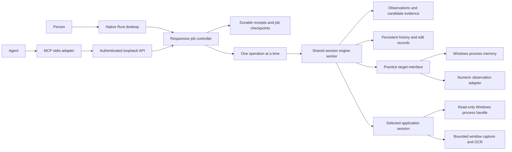

# Shared engine, two interfaces

The engine worker exclusively owns the target. A separate controller thread
owns the job journal and dispatches one engine operation at a time. The UI
renders published snapshots and queues commands. HTTP joins the same controller;
status and job-control replies do not wait for a native capture. Other commands
receive their completed engine state. OS file locks protect both the session
directory and journal. No extra target handles or per-job engine workers are
created.

The practice target is a separate owned process. It reports only its byte-arena boundary
and observations. Discovery enumerates naturally aligned numeric representations
and robust affine mappings, reserving the second half of the trajectory for
validation. Its result is evidence of correspondence, not proof of authority.

The current experiment applies +3 and -4 interventions, advances two idle ticks,
checks both observed channels, and restores the original arena between trials.
Only a single surviving hypothesis is editable. This is **practice-only**:
real-game rollback cannot overwrite an entire active region, and two scalar
observations cannot establish absence of hidden side effects.

Successful changes record before/after bytes, observation values, and a session
identity. Restore compares current bytes to the recorded result first. Metadata
is saved by replacing a synchronized temporary file. This is not yet a
crash-transactional write journal; interruption between a process write and
metadata save remains a limitation. Startup invalidates active addresses.

## Selected applications

The application picker and MCP `list_processes` use the same inventory of visible,
titled windows on the engine's Windows desktop. Selection carries a PID,
creation-time identity, and exact window handle. Attach checks these again
before taking a read-only process handle. Failed replacement leaves the current
connection intact. Idle polling invalidates the connection when the process
exits. Disconnect releases the connection without terminating the application.

`LiveSession` is independent of practice's fixed channels and oracle. It plans
bounded 64 KiB reads of committed writable regions, prioritizing writable image
regions and then smaller non-image regions. The desktop budgets 16 MiB per moment;
the API permits 1–32 MiB. Up to 20 moments and 512 MiB of raw snapshots are
retained per memory batch; this is not a whole-process memory ceiling.
Coverage is explicit. Pages unavailable in any sample are excluded from
correlation; missing OCR detections remain gaps, not zeros.

`advance_memory` archives observations and hypotheses, retains up to 256 sparse
byte witnesses, and releases the old raw snapshots before collecting a fresh
batch from previously unselected addresses. Interval subtraction preserves
unvisited suffixes of partially selected regions. Selection does not restart at
an earlier address when protection changes, so repeated churn cannot force the
planner to reselect that address indefinitely. It also means changed/reused
addresses are not revisited automatically.

Each chunk's allocation base, protection, type and containing range are checked
before and after a read. An observed incompatibility retires that chunk for the
rest of the batch; failed reads remain missing. Identical metadata cannot prove
allocation continuity. Native inventory errors are distinguished from the
documented upper-address boundary and query/region counts are bounded.

Coverage separates selected/read address unions, complete local trajectories,
requested I/O, retained raw bytes and bytes actually compared. A complete
trajectory needs at least 12 successful captures in one batch, with no observed
mapping discontinuity. It does not require a usable visual track. Memory read
receipts retain timing relative to each capture and a disposition.

Limits per investigation: 24 batches, 4 GiB requested reads, 512 MiB image
allowance and 32 MiB batch archives. A renderer finishing after timeout retains
its 10 MiB reservation; native PNG encoding is capped before writing a file.
Image allowance and batch archives are separate from the bounded per-frame
metadata and visual manifests, not a global disk quota. There is no automatic
memory sweep or restart continuation. Native calls remain cooperatively bounded and cannot
be preempted. See [coverage validation](research/MEMORY_BATCHES.md).

Window capture first uses Windows Graphics Capture for the selected HWND through
the MIT `windows-capture` library. PrintWindow's client area is a compatibility
fallback, with its reason reported. A single capture worker and a five-second
wait bound renderer blocking without accumulating capture threads. A stalled
worker retains its slot until it actually finishes. Neither path captures a
monitor or the whole desktop. The graphics frame is cropped to the selected
window's client area using checked window geometry; a geometry mismatch falls
back with a warning. Resize invalidates track association. Images and capture
metadata remain on disk.

Memory is sampled immediately after the image, before OCR. Recognition runs on
the shared worker afterward; screen capture, memory read and recognition durations
are reported separately. This reduces inference-induced sampling delay but does
not make screen and memory capture atomic.

Windows OCR and optional pinned PP-OCRv6 medium models run locally. The native
`reversebolt-vision` crate uses RTen, with four inference threads, bounded
detection and recognition tensors, and checksums before model loading. CTC word
positions approximate word geometry within detected text lines. Each word carries
its source and bounds. Fresh numeric detections establish up to 64 regions that
can be re-read on later frames, with at most three missed detections. Recovery
never enlarges or refreshes its own seed geometry; resize and errors clear it.
Legacy Ocrs installations remain supported when PP-OCRv6 is absent. Only one
neural model version participates, alongside independent Windows OCR.
Neural recognition is currently limited to 2.1 million source pixels; unsupported
sizes, missing models and errors retain Windows observations with warnings.

Overlapping numeric readings are grouped; different values or a box bridging
distinct fields produce an explicit uncertain observation with all alternatives,
not a majority vote. These become `None` in matcher input. Agreement remains
provisional, not calibrated confidence. Direct spatial overlaps reserve their
tracks before any proximity fallback. Competing assignments become explicit gaps
independently of iteration order. Neighboring letters are not forcibly
converted into digits. Numeric tracks retain per-frame reading evidence as well
as samples; nearby text is a description, not a semantic gameplay label.

After at least 12 moments, the same general numeric matcher compares varied OCR
tracks against captured memory. Results retain absolute locations as hypotheses
only. Native causal intervention and arbitrary application writes are not
implemented; practice write commands never target this session.

## External visual observations

`visual.rs` defines typed, image-bound interpretations from agent or human
transports. Each investigation and image has a fresh identity; image bytes are
hashed and checked when read or used for a new submission. Scalar, boolean,
text and vector values keep provenance and explicit provisional/uncertain
status. Only provisional scalars enter memory correlation. The producer is
responsible for observing the image; the engine cannot certify a claimed model
name or the truth of its interpretation. OCR remains an independent channel.

MCP `read_capture` returns an image block, and `submit_observation` uses the
same serial engine owner as the desktop. External series are bounded to 32 and
aligned to the current batch's at most 20 captured moments. Duplicate submissions are no-ops;
conflicting replacements, geometry changes and stale identities are checked.
Accepted interpretations are saved in a local evidence manifest before they
are published, independently of active-session metadata. The manifest remains
historical on restart, with no restored process handle or write capability.

Single-frame evidence is insufficient for rates, animation or causal claims.
The temporal observation protocol now binds 2–8 ordered images and their capture
intervals to one declared appearance, screen-motion or change interpretation.
Image and memory-read intervals share an investigation-local monotonic clock.
Elapsed bounds, omitted moments and gaps remain explicit. Temporal series are
saved before publication, immutable on replay, invalidated by geometry/target
changes and archived with their memory batch. They are excluded from scalar
correlation; no continuous identity, physical motion or authority is established.
See [temporal evidence](research/TEMPORAL_EVIDENCE.md).

Temporal semantic inference, an automatic model executor and calibrated
uncertainty remain required work. Memory coverage and capture-only jobs use
reviewed integrations of their isolated prototypes; neither implies semantic
understanding or general causal experiments.

## Observation job controller

The `reversebolt-session-jobs` crate supplies bounded durable state transitions,
request receipts, event cursors, pause/cancel and human takeover. Its application
executor accepts only typed capture steps. Every step pins the investigation,
batch, process creation identity and HWND, checked again by the engine before
capture. Delay is outside the durable operation intent so pausing between
captures does not manufacture a completed step.

The controller records intent before sending a capture to the sole worker.
It polls a completion channel without blocking command processing. A pause or
cancel can be acknowledged while that channel is pending. The worker's actual
outcome is recorded before releasing ownership. A timed-out renderer also
retains its slot until its thread finishes. Poll-budget exhaustion requests
drain of that owned operation, never replacement work. Storage failure fences
dispatch; a settled result may be exposed as volatile if it cannot be persisted.

On restart, the ledger is historical, the boot changes, and pending work is
interrupted without auto-resume. Exact retained command retries return the
original receipt; they do not replay captures. A durable intent without an
outcome is unknown even for read-only captures. Journal checkpoints and evidence
files are separate writes, not an atomic cross-file transaction. The library's
generic effect/consent tests do not expose production write operations.

See [MCP contract](MCP.md#durable-observation-jobs) and
[integration evidence](research/OBSERVATION_JOBS.md) for limits and failure cases.

## Automatic reports and prospective checks

A successful application connection schedules one durable 16-moment report in
the same controller used by explicit observation jobs. The attachment response
returns its receipt before any capture completes. The first step has no delay;
later steps wait one second after completion. Each step pins the target and batch.
Comparison runs within the existing worker from capture 12, so partial reports
appear before the bounded pass ends. Insufficient variation remains an ordinary
report result. Stop, pause, takeover and restart interruption keep their existing
ownership rules. Manual agents can opt out with `auto_observe:false`.

`prediction` checks freeze one selected series' current coefficients and scope.
Fresh captures retain candidate bytes, frame identities and read receipts;
external interpretations can arrive later for those exact frames. Observation
agreement cannot establish authority or distinguish identical copies. A frozen
check blocks refitting until the batch changes. Geometry/process/mapping changes
and failed evidence persistence invalidate scope. The file is historical after
restart, never an active handle or write capability. Initial fitting bytes are
not retained by this check. See [evaluation](research/FROZEN_PREDICTIONS.md).

## Next architectural boundaries

1. Broader renderer support, efficient incremental snapshots and coverage planning.
2. A timestamped observation bus: screen tracks, motion, appearance, input, audio.
3. Hypotheses over objects and relationships, not two fixed scalar tracks.
4. Experiment proposals, confidence calibration, scoped write journals and
   verifiable recovery without assuming a paused whole arena.
5. Broader investigation jobs, multiple agent identities, journal lifecycle and performance budgets.
6. Learned re-identification and withheld independent-game evaluation.

These boundaries should replace practice assumptions rather than disguise them
as general capabilities. Reuse Squalr findings, but retain independent MIT code
unless a deliberate licensing decision is made.
