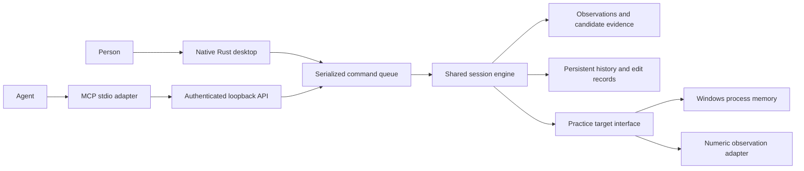

# Shared engine, two interfaces

The worker exclusively owns the target. The UI renders published snapshots and
queues commands; experiments never block its event loop. HTTP calls join that
same queue and receive the completed state. Access to the engine's session
directory is protected by an OS file lock.

The target is a separate owned process. It reports only its byte-arena boundary
and observations. Discovery enumerates naturally aligned numeric representations
and robust affine mappings, reserving the second half of the trajectory for
validation. Its result is evidence of correspondence, not proof of authority.

The current experiment applies +3 and -4 interventions, advances two idle ticks,
checks both observed channels, and restores the original arena between trials.
Only a single surviving hypothesis is editable. This is **practice-only**:
real-game rollback cannot overwrite an entire active region, and two scalar
observations cannot establish absence of hidden side effects.

Successful changes record before/after bytes, observation values, and a session
identity. Restore compares current bytes to the recorded result first. Metadata
is saved by replacing a synchronized temporary file. This is not yet a
crash-transactional write journal; interruption between a process write and
metadata save remains a limitation. Startup invalidates active addresses.

## Next architectural boundaries

1. Native target inventory and bounded read sessions, with incremental snapshots.
2. A timestamped observation bus: screen tracks, motion, appearance, input, audio.
3. Hypotheses over objects and relationships, not two fixed scalar tracks.
4. Experiment proposals, confidence calibration, scoped write journals and
   verifiable recovery without assuming a paused whole arena.
5. Durable cancellable jobs, human/agent takeover and identity, performance budgets.
6. Learned re-identification and withheld independent-game evaluation.

These boundaries should replace practice assumptions rather than disguise them
as general capabilities. Reuse Squalr findings, but retain independent MIT code
unless a deliberate licensing decision is made.
