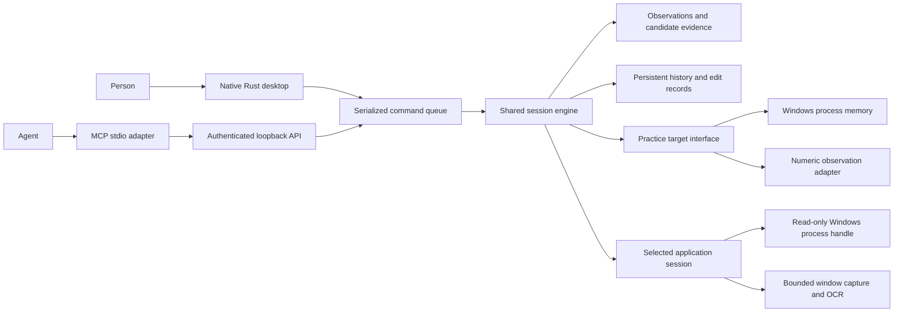

# Shared engine, two interfaces

The worker exclusively owns the target. The UI renders published snapshots and
queues commands; experiments never block its event loop. HTTP calls join that
same queue and receive the completed state. Access to the engine's session
directory is protected by an OS file lock.

The practice target is a separate owned process. It reports only its byte-arena boundary
and observations. Discovery enumerates naturally aligned numeric representations
and robust affine mappings, reserving the second half of the trajectory for
validation. Its result is evidence of correspondence, not proof of authority.

The current experiment applies +3 and -4 interventions, advances two idle ticks,
checks both observed channels, and restores the original arena between trials.
Only a single surviving hypothesis is editable. This is **practice-only**:
real-game rollback cannot overwrite an entire active region, and two scalar
observations cannot establish absence of hidden side effects.

Successful changes record before/after bytes, observation values, and a session
identity. Restore compares current bytes to the recorded result first. Metadata
is saved by replacing a synchronized temporary file. This is not yet a
crash-transactional write journal; interruption between a process write and
metadata save remains a limitation. Startup invalidates active addresses.

## Selected applications

The application picker and MCP `list_processes` use the same inventory of visible,
titled windows on the engine's Windows desktop. Selection carries a PID,
creation-time identity, and exact window handle. Attach checks these again
before taking a read-only process handle. Failed replacement leaves the current
connection intact. Idle polling invalidates the connection when the process
exits. Disconnect releases the connection without terminating the application.

`LiveSession` is independent of practice's fixed channels and oracle. It plans
bounded 64 KiB reads of committed writable regions, prioritizing writable image
regions and then smaller private regions. The desktop budgets 16 MiB per moment;
the API permits 1–32 MiB. Up to 20 moments and 512 MiB are retained in memory.
Coverage is explicit. Pages unavailable in any sample are excluded from
correlation; missing OCR detections remain gaps, not zeros.

Window capture uses `PrintWindow` for the selected client area, followed by
Windows OCR. A single capture worker and a five-second wait bound renderer
blocking without accumulating capture threads. It does not fall back to the
whole desktop. Images remain on disk. The current numeric tracker associates
whole numeric words by screen position; nearby text is a description, not a
semantic gameplay label. Screen and memory capture are sequential, not atomic.

After at least 12 moments, the same general numeric matcher compares varied OCR
tracks against captured memory. Results retain absolute locations as hypotheses
only. Native causal intervention and arbitrary application writes are not
implemented; practice write commands never target this session.

## Next architectural boundaries

1. Broader renderer support, efficient incremental snapshots and coverage planning.
2. A timestamped observation bus: screen tracks, motion, appearance, input, audio.
3. Hypotheses over objects and relationships, not two fixed scalar tracks.
4. Experiment proposals, confidence calibration, scoped write journals and
   verifiable recovery without assuming a paused whole arena.
5. Durable cancellable jobs, human/agent takeover and identity, performance budgets.
6. Learned re-identification and withheld independent-game evaluation.

These boundaries should replace practice assumptions rather than disguise them
as general capabilities. Reuse Squalr findings, but retain independent MIT code
unless a deliberate licensing decision is made.
